# Procedural Planets

**Planeten in Echtzeit im Browser, gerechnet statt gemalt.** Gasriesen entstehen aus einer
Strömungssimulation auf der Kugel. Gesteinsplaneten bekommen aus einem Seed Gelände, Flüsse, Meere,
Luft und Wolken, und ein ganzes Sonnensystem mit Dutzenden Körpern läuft mit Newtonscher Schwerkraft
und physikalisch modellierten Kollisionen. Gezeichnet wird alles mit WebGPU, Bildtexturen gibt es
keine: Jedes Wolkenband, jede Küste und jede Trümmerwolke kommt aus Gleichungen und Zahlen.

<p align="center">
  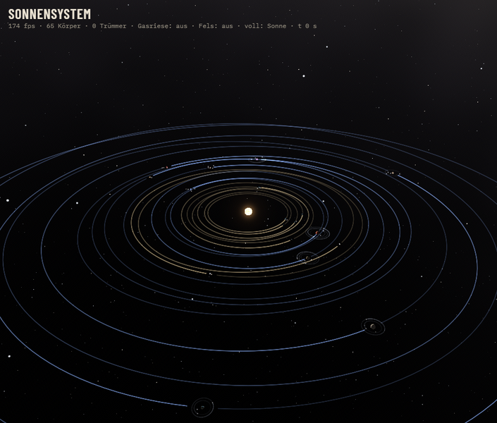
</p>

**▶ Gleich ausprobieren (ohne Installation):**
[Sonnensystem](https://loveascent.github.io/procedural-planets/index.html?body=welt) ·
[Gasriese](https://loveascent.github.io/procedural-planets/index.html) ·
[Gasriese, flauschiges Argh-Volumen](https://loveascent.github.io/procedural-planets/index.html?argh=1) ·
[Gesteinsplanet](https://loveascent.github.io/procedural-planets/index.html?body=rocky) ·
[Sahne im Kaffee](https://loveascent.github.io/procedural-planets/coffee.html) ·
[alle Versionen seit v0.1](#versionen-vom-ersten-prototyp-bis-zum-sonnensystem)

Braucht einen Browser mit WebGPU: Chrome/Edge 113+, Safari 26+, Firefox 141+, Android-Chrome 121+.
Die Oberfläche ist deutsch und englisch (Knopf oben rechts).

Von **loveascent** · [Apache-Lizenz 2.0](LICENSE) · [Quellen und Dank](docs/de/CREDITS.md) ·
[Zitieren](CITATION.cff) · [English](README.md)

| Gasriese | Gesteinsplanet | Einschlag im Sonnensystem |
|---|---|---|
| 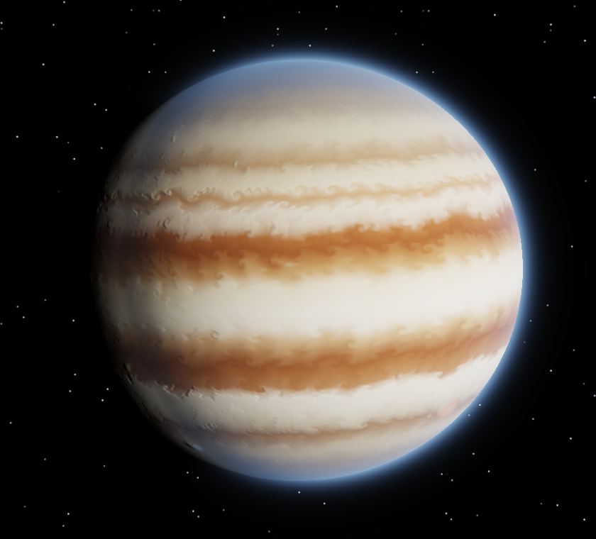 | 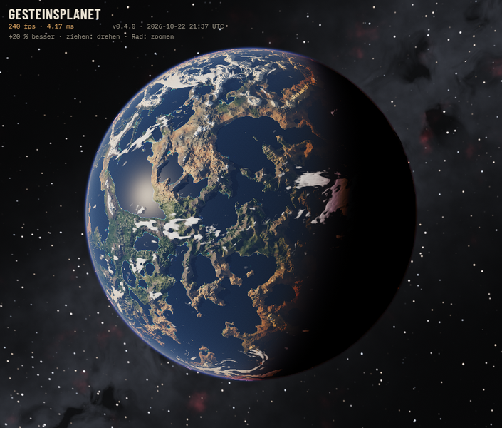 | 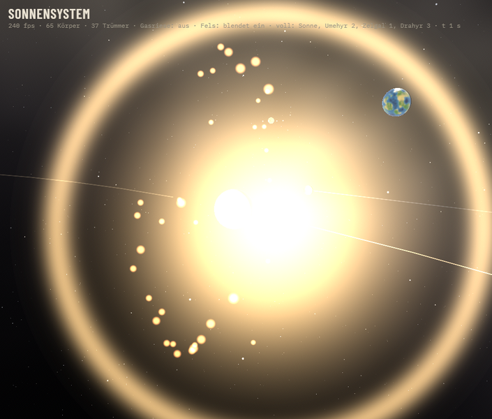 |

| Saturn | Gasriese im System | Gesteinsplanet im System |
|---|---|---|
| 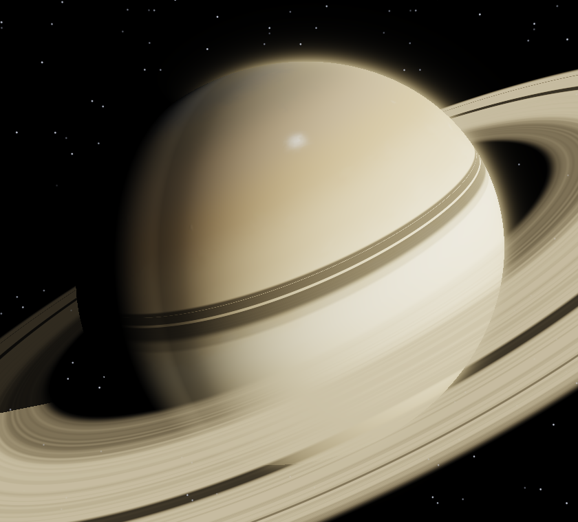 | 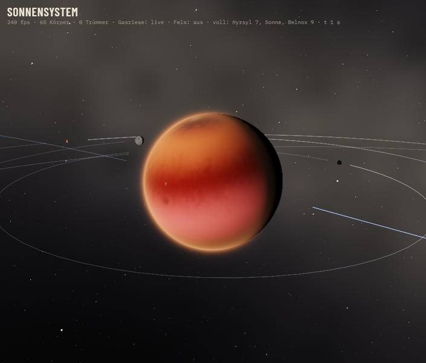 | 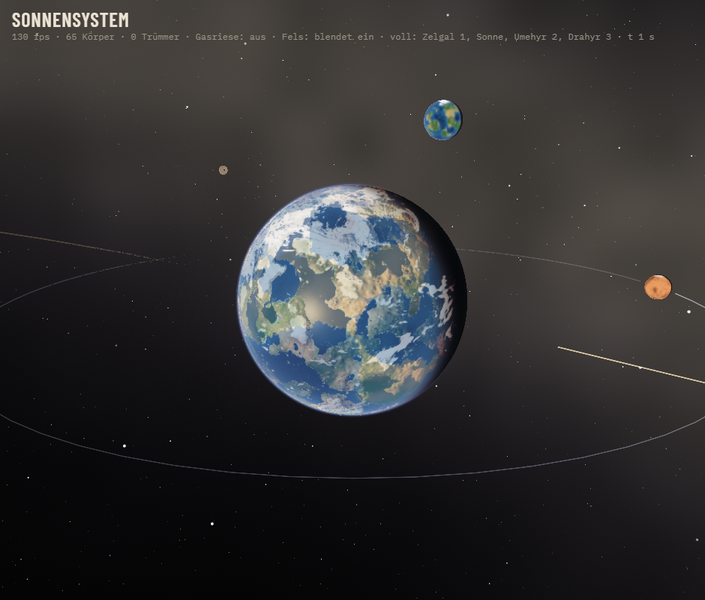 |

*Alle Bilder sind Aufnahmen dieses Projekts, keine Fotos. Die Bilder von Sonnensystem und
Gesteinsplanet entstanden auf einer RTX 5080 bei 1280 × 800; die Statuszeile zeigte dabei
130–240 fps bei 65 Körpern.*

---

## Was man damit machen kann

- **Sonnensystem:** eine Sonne, 20 Planeten und ihre Monde, ein Seed für das ganze System. Zu jedem
  Körper fliegen (Doppelklick), Asteroiden darauf werfen oder zwei Planeten auf Kollisionskurs setzen,
  das Zeittempo ändern, das System als Datei, im Browser oder als kurzen Code speichern und laden.
  Jeder Körper hat einen Steckbrief mit Werten aus der laufenden Simulation.
- **Gasriese:** Jupiter, Saturn, Uranus, Neptun, ein heißer Jupiter oder ein Zufallsplanet aus fünf
  Familien. Rund 50 Regler, jeder erklärt, was er physikalisch ändert, und zeigt seine Formel.
  Dazu Rückgängig/Wiederholen, Speicherplätze, Planeten-Codes zum Teilen und „Farben aus Bild“.
- **Gesteinsplanet:** für jeden Seed eine neue Welt mit Meeresspiegel, Erosion, Gebirgsgürteln,
  Flüssen und Seen, Vulkanen, Meereis, Wolken und Atmosphäre. Ein schaltbarer Modus „Original 1:1“
  zeigt das Verfahren, mit dem dieser Teil begonnen hat.
- **Jede Funktion ist ein Schalter.** Gasriese, Gesteinsplanet und Sonnensystem bestehen aus kleinen
  Bausteinen. Jeder lässt sich abschalten, abgeschaltete Shader-Teile werden gar nicht erst übersetzt.
  So sieht man genau, was jeder Baustein beiträgt.

## Versionen: vom ersten Prototyp bis zum Sonnensystem

Jede Version ist ein Commit mit Tag in diesem Repository (`git checkout v0.4.0`). Die eingefrorenen
Fassungen laufen direkt im Browser.

| Version | Datum | Was dazukam | Spielen |
|---|---|---|---|
| **v0.1.0** | 25.09.2026 | Gasriesen-Prototyp: Stable Fluids und Partikel auf der Würfelkugel, fünf Planeten, erklärte Regler | [Gasriese v0.1](https://loveascent.github.io/procedural-planets/gas-v0.1.html) |
| **v0.2.3** | 25.09.2026 | Ladebildschirm, Auto-Qualität, Zufallsplaneten, Speicherplätze, Planeten-Codes, Rückgängig, Kaffee-Demo | [Kaffee](https://loveascent.github.io/procedural-planets/coffee.html) |
| **v0.4.0** | 26.09.2026 | Getrennte Spuren Fluid, Partikel und Hybrid; Simulation unabhängig von der Bildrate; rückläufige Drehung; Formel zu jedem Regler; Filmstreifen | [Gasriese v0.4](https://loveascent.github.io/procedural-planets/gas-v0.4.html) |
| **v0.5.0** | 27.09.2026 | Gesteinsplaneten neben den Gasriesen; gemeinsamer Milchstraßen-Himmel | [Gestein v21](https://loveascent.github.io/procedural-planets/planets-v21.html) |
| **v0.6.0** | 28.09.2026 | Quadtree-Geländekacheln, Flüsse und Seen aus dem Gelände, Vulkane, Flüsse als Meerwasser | [v22](https://loveascent.github.io/procedural-planets/planets-v22.html) · [v23](https://loveascent.github.io/procedural-planets/planets-v23.html) · [v24](https://loveascent.github.io/procedural-planets/planets-v24.html) · [v25](https://loveascent.github.io/procedural-planets/planets-v25.html) |
| **v0.7.0** | 29.09.2026 | Eine Seite für alle Körper, eingefrorene Versionen im Kopf wählbar, Relief, Parallaxe-Eigenschatten, Dämmerungssaum, Menüs mit Suche | [aktuelle Seite](https://loveascent.github.io/procedural-planets/index.html) |
| **v0.8.0** | 06.10.2026 | Alles in schaltbare Bausteine zerlegt; deterministische Bildprüfungen belegen: kein Pixel verändert | (Quelltext) |
| **v0.9.0** | 06.10.2026 | Sonnensystem: 20 Planeten, Monde und Sonne, N-Körper-Schwerkraft, Kollisionen mit Zerschlagung und Trümmern | (Quelltext) |
| **v1.2.0** | 24.11.2026 | Gasriese: Modul „Argh-Volumen“ (Abschnitt Relief): Arghanions Volumen-Gasriese (Dichtekörper von der Farbe verschoben, Einfachstreuung, Schattenstrahl zur Sonne), live angetrieben vom simulierten Farbstoff statt eines Fotos | [Gasriese](https://loveascent.github.io/procedural-planets/index.html) |
| **v1.1.0** | 24.10.2026 | Mond (`?body=moon`): Motor des Gesteinsplaneten mit Kraterformel statt Vulkanformel | [Mond](https://loveascent.github.io/procedural-planets/index.html?body=moon) |
| **v1.0.0** | 06.10.2026 | Kollisionsmodell nach Leinhardt & Stewart (2012), echte Gasriesen und Gesteinsplaneten laufen live im System, Speichern/Laden, Steckbriefe | [Sonnensystem](https://loveascent.github.io/procedural-planets/index.html?body=welt) |

Dieselben Versionen stehen auch im Menü „aktuell“ im Seitenkopf. Eine Galaxiekarte mit vielen
Sonnensystemen ist geplant und im Kopf ausgegraut zu sehen.

## So funktioniert es

### Gasriesen: eine Flüssigkeit auf der Kugel (`src/gas/`)
- **Stable Fluids auf der Würfelkugel** (Stam 1999; GPU-Aufbau nach Harris 2004). Semi-Lagrange-Advektion
  mit BFECC/MacCormack-Korrektur, Druckprojektion mit Jacobi-Iterationen, Corioliskraft und
  Wirbelverstärkung (Fedkiw u. a. 2001). Die Würfelkugel statt einer Längen-/Breitenkarte hat keine
  Pol-Singularität. Wind ist als 3D-Tangentialvektor gespeichert, Ableitungen nutzen die echte
  Gittermetrik, und das Abtasten bleibt über Würfelkanten hinweg exakt.
- **Jets und Stürme aus Messungen:** Windprofile nach Cassini- und Hubble-Daten (Porco u. a. 2003;
  Tollefson u. a. 2017; García-Melendo u. a. 2011; Sromovsky u. a.) treiben die Bänder. Stürme sind
  Wirbel, deren Drehsinn der örtlichen Scherung folgt.
- **Partikel-Spur:** Millionen Partikel im Curl-Noise-Feld (Bridson u. a. 2007), die zu einer Mittelfarbe
  verblassen, nach jasper-r und dem Rezept von Gaseous Giganticus. Fluid, Partikel und Hybrid laufen
  als getrennte Spuren, nicht als ein vermischtes Verfahren.
- **Fester Zeitschritt:** Die Simulation rechnet in festen Schritten unabhängig von der Bildrate. Ein
  60-Hz-Laptop und ein 240-Hz-Rechner zeigen dieselbe Atmosphäre, und der Zeitraffer behält die Physik.
- **Darstellung:** abgeplattetes Ellipsoid, Minnaert-Randverdunklung, Wolkenrelief mit
  Parallaxe-Eigenschatten, Dunstsaum, Ringe mit Schatten, ACES-Tonemapping.
- **Argh-Volumen (Schalter, Standard aus):** die Wolkendecke als echter, flauschiger Dichtekörper nach Arghanions Blender-Tutorial,
  mit einer scharfen Karte, die der simulierte Wind mitnimmt. Siehe [Argh-Volumen](#argh-volumen-ein-flauschiger-volumen-gasriese) unten.

### Argh-Volumen: ein flauschiger Volumen-Gasriese

*(`src/gas/arghkarte.ts`, `src/gas/shader/argh_karte.ts`, `src/gas/shader/argh.ts`; Schalter „Argh-Volumen (Arghanion)“ im Abschnitt Relief, Standard aus)*

Die Wolkendecke wird als echter Dichtekörper gezeichnet statt als aufgemalte Fläche, nach Arghanions Blender-Tutorial
(aus dem Knotenbaum neu gebaut, keine Dateien übernommen). Die Farbe C verschiebt eine Kugel, `q = p ⊙ (1 − f + f·C)`, eine konstante
Farbrampe macht daraus eine dichte Haut, und Einfachstreuung mit Schattenstrahl zur Sonne beleuchtet sie. Ergebnis: buckelige
Silhouette und Terminator und eine weiche, wollige Haut.

| Jupiter, ganzer Planet | Jupiter, Nahansicht (ohne Foto) | Nahansicht mit Foto-Karte 4096 × 2048 |
|---|---|---|
| 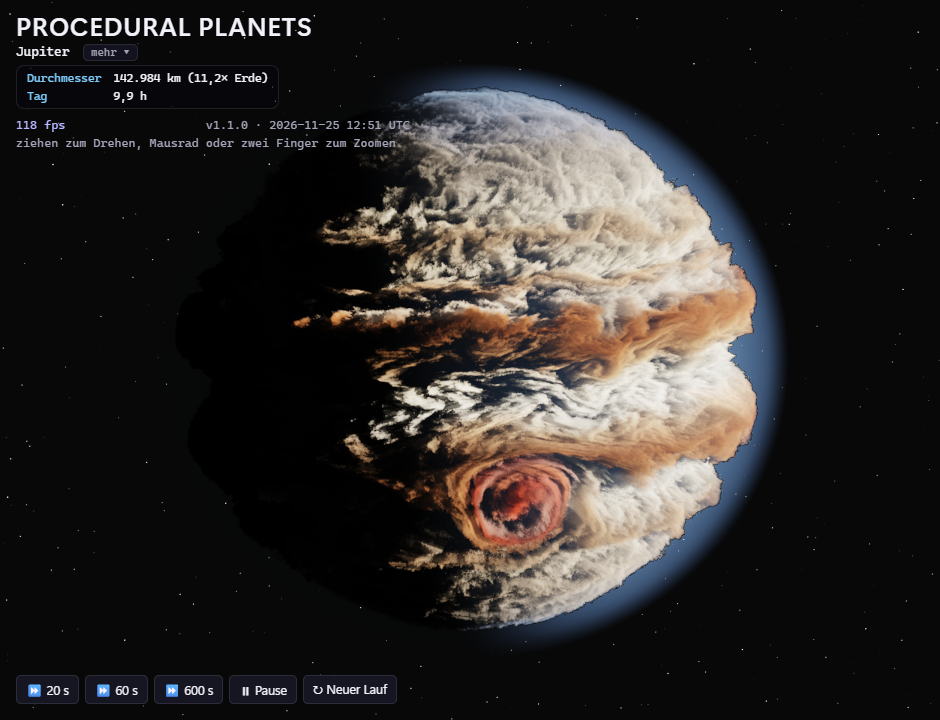 | 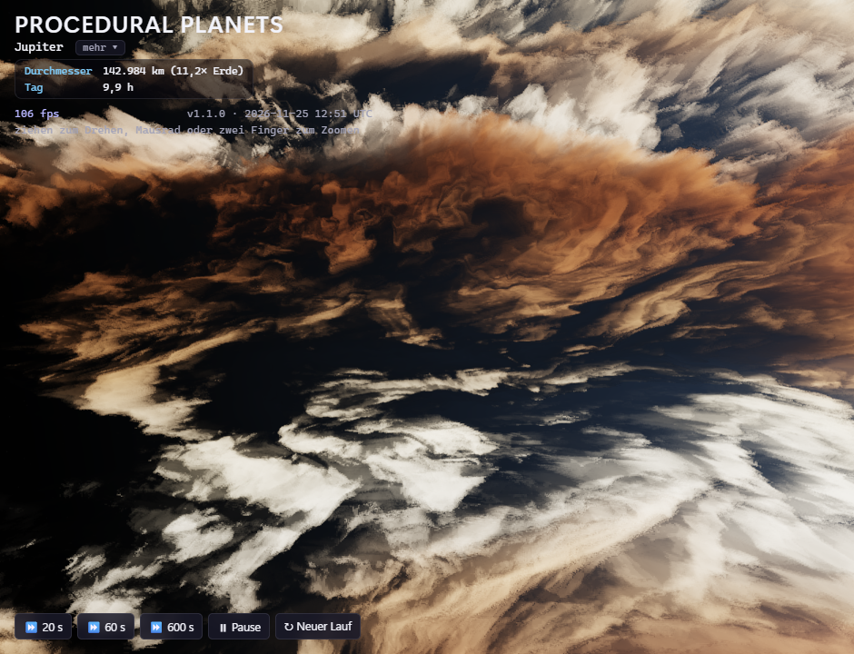 | 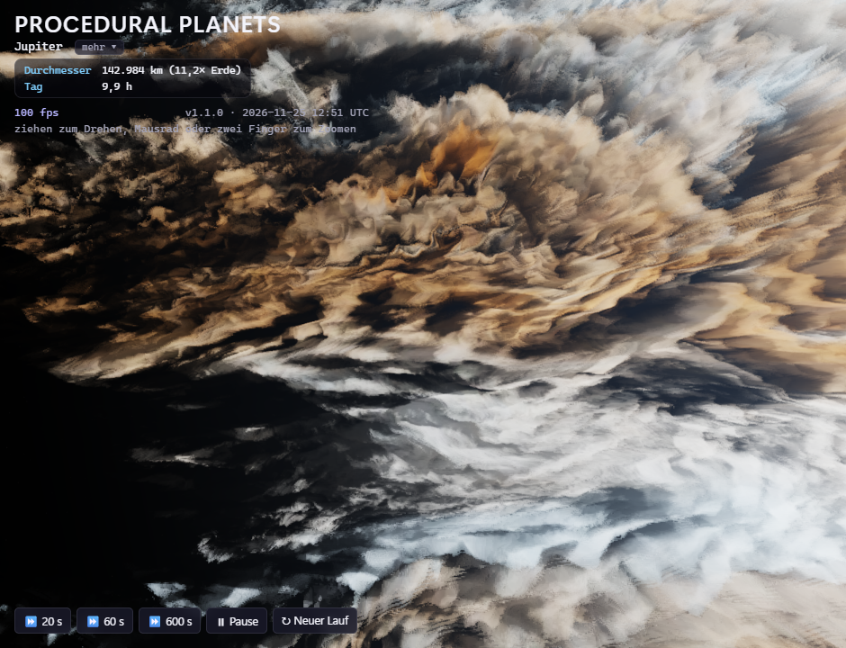 |

| Saturn | Neptun |
|---|---|
| 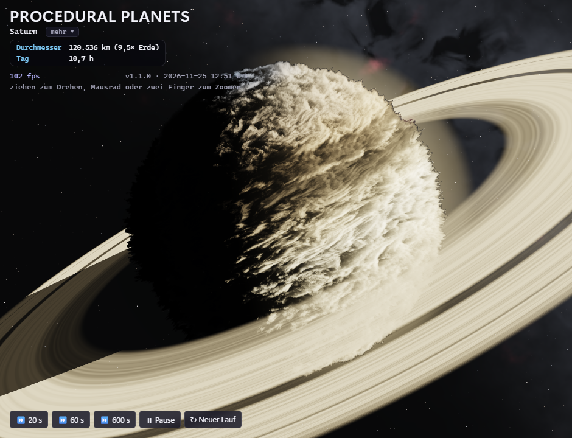 | 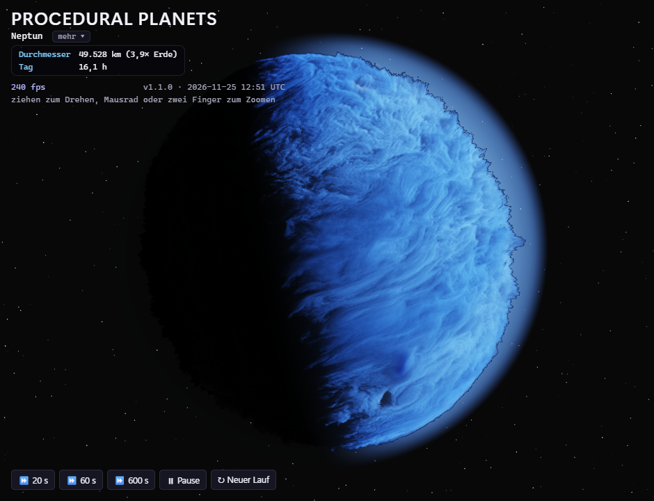 |

*Renderings dieses Projekts (Chrome auf einer RTX 5080, Fenster 1280 × 720, Pixeldichte 2). Foto-Karte im dritten Bild:
Jupiter 4096 × 2048 von [Solar System Scope](https://www.solarsystemscope.com/textures/) (CC BY 4.0). Der fps-Zähler im Bild ist der Live-Wert
eines headless-Laufs und nicht die Messung unten.*

**Wie der Flausch entsteht (und was gemessen wurde):**

- **Karte über Wind (Standard-Farbquelle):** Eine scharfe Referenzkarte wird vom simulierten Wind verschoben (Neyret 2003, *Advected
  Textures*): getragen werden die Textur-*Koordinaten*, nicht die Textur, darum bleibt die Karte scharf statt zu verwischen. Die
  Koordinaten werden als Abweichung von der Identität gespeichert (eine absolute Richtung in `rgba16f` zeigt in der Nahansicht Treppenstufen)
  und fallen zur Identität zurück (`arghRelax`). Ohne Foto startet die Karte sofort aus der Anfangsfarbe des Planeten plus Wolkendetail,
  ohne Vorlauf. Ein Foto braucht mindestens 4096 × 2048 (2:1); ein kleines oder nicht 2:1 großes Bild ergibt nur Klumpen.
- **Weiche Haut:** `K` Streupunkte je Pixel (Standard 10, Handy 3) mit einer fast harten Dichterampe (0,1 freie Weglängen an der Hautkante,
  wie die Farbrampe „Constant“ des Tutorials), ungeglätteter Höhe (Mip-Stufe 0) und einer dünnen Dunstschale (6 %) bis zur Haut, damit unter dem Dunst kein dunkles Band entsteht.
  Die Nachtseite wird exakt übersprungen.
- **Abtastung der Streupunkte (Regler „Argh: Abtastung der Streupunkte“)** — drei Auswahlen, alle bleiben erhalten:
  `fest` (ein festes Muster, kann Stufen zeigen), `verschachtelt` (**Standard**: jeder Pixel einer 3 × 3-Kachel nimmt einen anderen festen Versatz,
  eine 3 × 3-Auflösung mittelt die neun; neunfache Abtastung der Streupunkte allein, ohne Rauschen; Verschachteltes Abtasten,
  Keller & Heidrich 2001) und `zufall` (je Pixel gewürfelt wie im Blender-Demo: sehr flauschig, aber körnig).

| fest | verschachtelt (Standard) | Zufall |
|---|---|---|
| 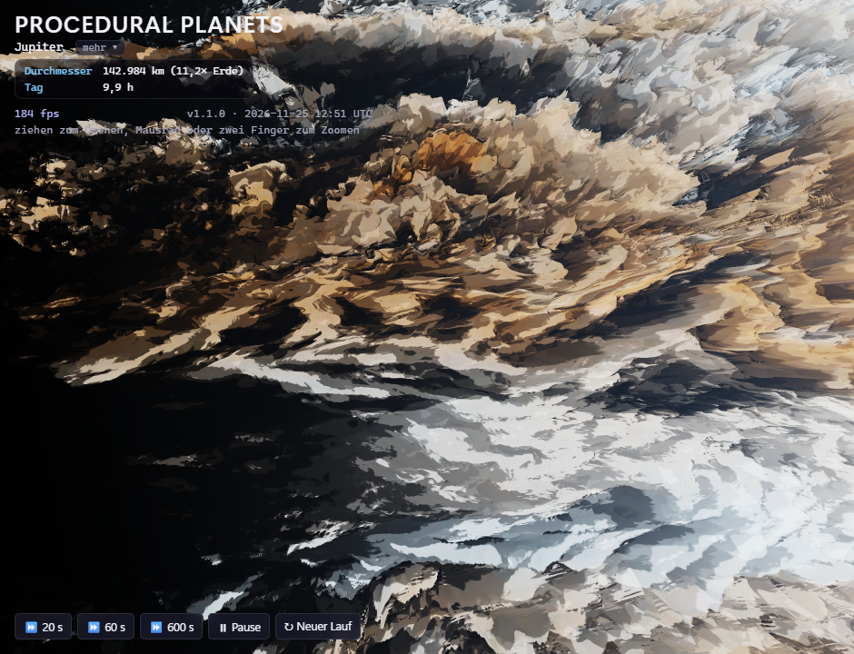 | 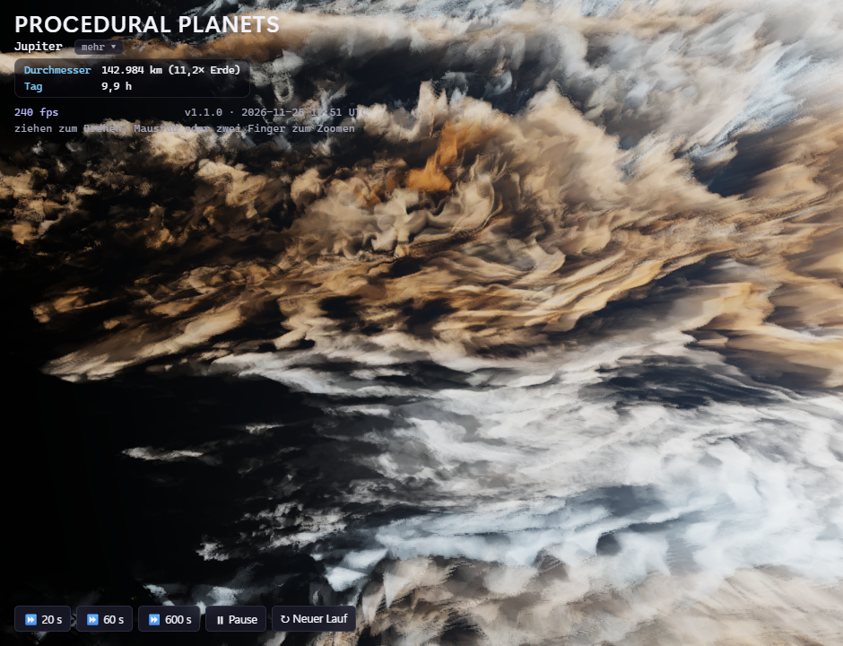 | 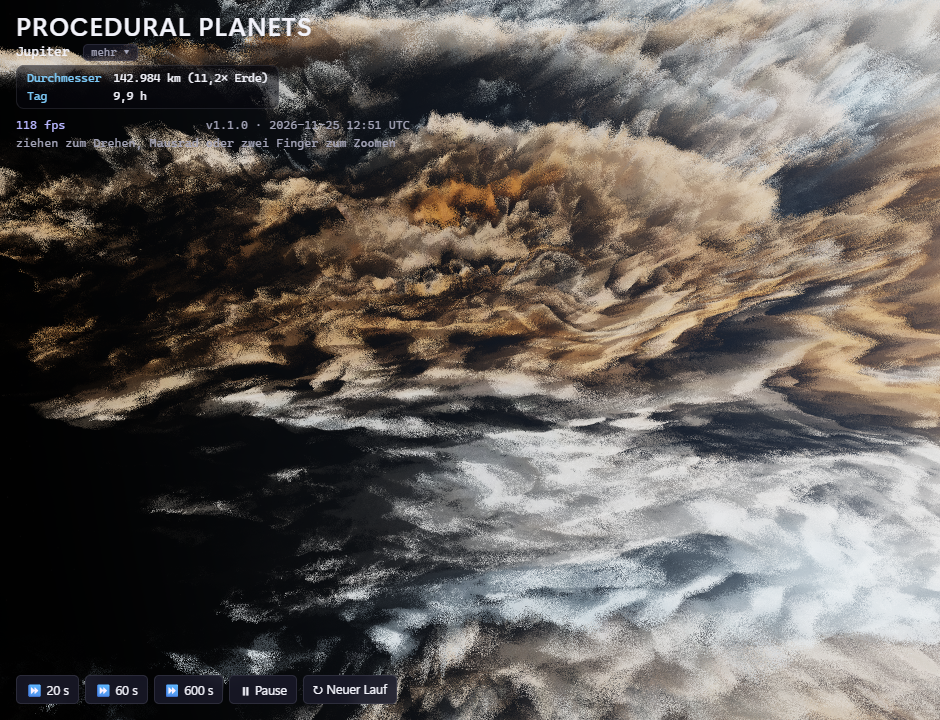 |

Gemessen auf der RTX 5080 (Chrome headless, Jupiter, Pixeldichte 2, Canvas 1880 × 1440, requestAnimationFrame-Zählung über 5 s, vsync aus),
**Median aus drei Läufen** (die GPU wurde mit anderen Aufgaben geteilt, einzelne Läufe schwankten um den Faktor zwei bis vier; die Spanne steht dabei):

| Konfiguration | Median ms je Bild (Spanne) | ≈ fps |
|---|---:|---:|
| Argh aus | 0,14 (0,13–0,16) | 7000 |
| Foto-Karte, verschachtelt, K = 10 (Standard) | 4,1 (4,0–4,8) | 243 |
| Foto-Karte, verschachtelt, K = 3, Schatten 4 (Handy-Einstellung) | 2,1 (1,6–3,3) | 486 |
| Foto-Karte, fest, K = 10 | 3,1 (2,6–4,3) | 326 |
| Foto-Karte, Zufall, K = 10 | 3,0 (2,9–5,0) | 337 |
| Ohne Foto (Detailkarte), verschachtelt, K = 10 | 3,6 (3,2–4,2) | 281 |
| Live-Farbstoff als Farbquelle („B“), verschachtelt, K = 10 | 1,6 (1,5–7,3) | 623 |

Hochfrequenz-Energie eines 300 × 300-Ausschnitts in der Nahansicht mit Foto-Karte (Laplace / Helligkeit; kleiner = glatter, größer = körniger):
verschachtelt 0,085, fest 0,172, Zufall 0,388.
Im Sonnensystem mit eingeschaltetem Baustein und einem Gasriesen im Fokus (65 Körper): 239,5 fps mit, 239,6 fps ohne (der Zähler endet bei 240).

**Standardwerte und wie sie gefunden wurden:** Die ersten Standardwerte (f = 0,12, weiche Rampe 0,3, Höhenglättung 0,25) haben den Flausch ausgewaschen. Im Vergleich mit der
Standalone-Referenz bei gleicher Ansicht und Beleuchtung brachten die Werte des Tutorials (f = 0,211, harte Rampe „Constant“) die wollige, felle-artige Haut zurück,
auch ohne Foto und auch nach 60 s simulierter Strömung. Die Standardwerte sind jetzt f = 0,211, Rampe 0,1, Glättung 0.

**Ehrliche Grenzen:** Der Handy-Wert ist nur auf der RTX 5080 gemessen (K = 3), nicht auf einem Handy. Ohne Foto hat die Karte weniger feines Filigran
als mit Foto. Verschiebung `f = 0` ergibt nach der Formel oben eine glatte Kugel (gar kein Flausch); der Standard ist 0,211, „Regler zurücksetzen“
stellt ihn wieder her. Der zerklüftete Rand, auch auf der dunklen Seite, ist der echte verschobene Dichtekörper (ohne Argh ist der Rand glatt), kein Fehler. Alles hier ist ein Schalter (`arghOn`) und ein Satz Regler; von den älteren Verfahren wurde nichts entfernt.

Werkzeuge: [werkzeug/gas/argh-messen/](werkzeug/gas/argh-messen/LIES.txt) (`fps.py`, `mess2.py`, `metrik.py`, `bilder_readme.py`). Fassung mit Foto: [gasriese-volumen-demo](https://github.com/loveascent/gasriese-volumen-demo).

### Gesteinsplaneten: Gelände, Wasser und Luft aus einem Seed (`src/rocky/`, `src/sky/`)
- **Gelände:** Höhen- und Feuchtekarten je Würfelseite aus fBm- und Ridged-Simplex-Rauschen (Verfahren
  nach colordodge/ProceduralPlanet), Gebirgsgürtel als Ridged-Multifractal (Musgrave), Erosionsrinnen
  entlang r̂ × ∇h.
- **Detailstufen:** Quadtree-Geländekacheln mit Geomorphing (CDLOD, Strugar 2009), deshalb keine geraden
  Netzkanten beim Hineinzoomen.
- **Hydrologie:** Senken werden mit Priority-Flood zu Seen gefüllt (Barnes u. a. 2014), dazu
  Abflussakkumulation (O'Callaghan & Mark 1984) und Flussbreite und -tiefe aus der hydraulischen
  Geometrie (Leopold & Maddock 1953).
- **Wasser und Luft:** Sonnenglitzern nach Cox & Munk, Wasserabsorption nach Pope & Fry,
  Transmissionstabellen nach Bruneton, Rayleigh-/Mie-/Ozon-Koeffizienten nach Hillaire, Wolken aus
  verzerrtem Rauschen mit Henyey-Greenstein-Vorwärtsstreuung, GGX-Glanzlichter, Bloom.

### Sonnensystem: Physik auf der CPU, Aussehen auf der GPU (`src/welt/`)
- **Schwerkraft:** Newtonsches N-Körper-Problem mit symplektischem Leapfrog-Verfahren
  (Kick-Drift-Kick) im festen Teilschritt 1/120, mit Glättung gegen Singularitäten bei Beinahe-Treffern.
  Zwischen Physikschritten wird das Bild interpoliert, deshalb ruckelt auch langsame Zeit nicht.
  Planeten spüren wahlweise nur Sonne und Monde (stabil) oder alle Körper („Chaos“, die Bahnen laufen
  auseinander).
- **Kollisionen:** Ausgänge nach Leinhardt & Stewart (2012), also Verschmelzen, Hit-and-Run,
  teilweises Anwachsen, Erosion und superkatastrophale Zerschlagung, mit größtem Rest und
  Trümmermasse aus ihren Skalierungsgesetzen, gegengeprüft an der REBOUND-Umsetzung von Childs &
  Steffen (2022). Trümmer fliegen mit etwa der halben Einschlaggeschwindigkeit ab (Emsenhuber u. a.
  2024). Masse und Impuls bleiben erhalten, das prüft `npm run pruefen:welt`.
- **Bahnen** werden als Kepler-Ellipsen oder -Hyperbeln aus Ort und Geschwindigkeit gezeichnet.
- **Detailstufen:** Ferne Körper sind gebackene Kugeln, winzige sind Punkte. Der nächste große Gasriese
  und der nächste große Gesteinsplanet laufen als **echte Simulations-Instanzen** der Planetenmodule
  oben, auf einem gemeinsamen GPU-Gerät, mit Schatten und Finsternissen zwischen den Körpern.
- **Wiederholbar:** Ein Seed beschreibt das ganze System. Beim Speichern werden alle Körper, alle
  Einstellungen und die Kamera gesichert.

### Grundsätze
- **Physik vor Effekt:** Jedes Verhalten soll aus einer benennbaren Gleichung kommen. Wo der Code
  schummelt, steht das in der Doku.
- **Messen statt raten:** Deterministische Bildprüfungen (`werkzeug/bild`, `werkzeug/gas`) rendern feste
  Szenen und vergleichen sie pixelgenau. Physikprüfungen testen das Kollisionsmodell gegen die
  veröffentlichten Gleichungen.
- **Nachvollziehbar:** Jede Formel mit Fundstelle im Code steht in [docs/de/MATHEMATIK.md](docs/de/MATHEMATIK.md),
  jede Quelle in [docs/de/CREDITS.md](docs/de/CREDITS.md).

## Bauen und starten

```bash
npm install
npm run dev            # http://localhost:5173 (?body=rocky, ?body=welt)
npm run build          # dist/index.html und demo/: in sich geschlossene Einzeldateien
npm run pruefen:welt   # Physikprüfungen des Sonnensystems (Kollisionen, Erhaltungssätze)
```

`demo/index.html` ist eine einzige Datei mit allen drei Körpern. GitHub Pages veröffentlicht `demo/`
bei jedem Push auf `main` (Workflow in `.github/workflows/pages.yml`).

## Aufbau

```
src/app.ts, shell.ts   eine Seite für alle Körper (?body=gas|rocky|welt), Kopfzeile, Versionswahl
src/gas/               Gasriese: Felder, Rechenschritte, Stürme, Darstellung, Menüs (eine Datei je Baustein)
src/vorlagen/          Planetenvorlagen als Zahlen (Jupiter, Saturn, ...), Zufallsplaneten
src/rocky/             Gesteinsplanet: Gelände, Quadtree, Hydrologie, Wasser, Luft, Wolken (Shader-Bausteine in shader/)
src/sky/               gemeinsamer Sternen- und Milchstraßenhimmel
src/welt/              Sonnensystem: physik/ (Schwerkraft, Kollisionen, Szenarien), zeichnen/ (Darstellung), oberflaeche/ (Bedienfeld)
src/bedienung/         Bausteine des Bedienfelds (Suche, Regler, Tipps)
demos/coffee.html      Sahne im Kaffee (eigenständig)
demo/                  fertige Builds, auch alle eingefrorenen Versionen
docs/                  STATUS, ROADMAP, MATH, RESEARCH (englisch); docs/de/: deutsch
werkzeug/              Bild- und Physikprüfungen
```

## Quellen

Das Projekt baut auf veröffentlichten Verfahren und Messdaten auf. Fremder Code wurde nicht kopiert,
bis auf zwei kleine MIT-lizenzierte Rausch- und Hash-Funktionen, deren Lizenztext neben dem Code
steht. Die vollständige Liste, wofür welche Quelle verwendet wurde, steht in
[docs/de/CREDITS.md](docs/de/CREDITS.md) und, ausführlicher, in [CREDITS.md](CREDITS.md). Die wichtigsten:

- J. Stam, *Stable Fluids*, SIGGRAPH 1999 · M. Harris, *Fast Fluid Dynamics Simulation on the GPU*, GPU Gems 2004
- R. Fedkiw u. a., *Visual Simulation of Smoke*, SIGGRAPH 2001 · A. Selle u. a., MacCormack-Verfahren, 2008
- R. Bridson u. a., *Curl-Noise for Procedural Fluid Flow*, SIGGRAPH 2007
- jasper-r, *Gas giant particle sim on a sphere* (2022) · S. Cameron, *Gaseous Giganticus* (nur Rezept)
- colordodge, *ProceduralPlanet* (WTFPL) · Ashima Arts / S. Gustavson, *webgl-noise* (MIT) · D. Hoskins, *Hash without Sine* (MIT)
- F. Strugar, *CDLOD* (2009) · R. Barnes u. a., *Priority-Flood* (2014) · Leopold & Maddock (1953)
- E. Bruneton (2017) und S. Hillaire (2020), Atmosphärenstreuung · Cox & Munk (1954) · Henyey & Greenstein (1941)
- Z. Leinhardt & S. Stewart, *Collisions between Gravity-Dominated Bodies*, ApJ 745, 79 (2012)
- A. Emsenhuber u. a., *A New Database of Giant Impacts*, PSJ (2024) · S. Childs & J. Steffen, REBOUND-Fragmentierung (2022)
- Windprofile: Porco u. a. 2003, Tollefson u. a. 2017, García-Melendo u. a. 2011, Sromovsky u. a. 1993/2015

## Lizenz

[Apache-Lizenz 2.0](LICENSE). Nutzen, Ändern und Weitergeben ist erlaubt, auch kommerziell.
Weitergaben und abgeleitete Werke müssen die Datei [NOTICE](NOTICE) mitliefern (Abschnitt 4(d)).
Bitte zitiere das Projekt nach [CITATION.cff](CITATION.cff).
Schriften: IBM Plex und Barlow Condensed (SIL OFL), geladen über Google Fonts.
Gebaut mit Vite, TypeScript und vite-plugin-singlefile (MIT).

Umgesetzt mit Unterstützung von Claude (Anthropic) als KI-Programmierassistent.
