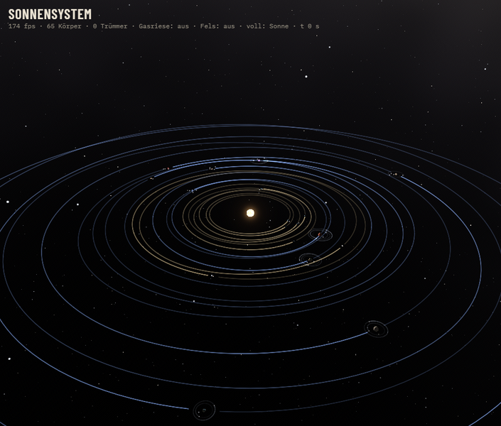
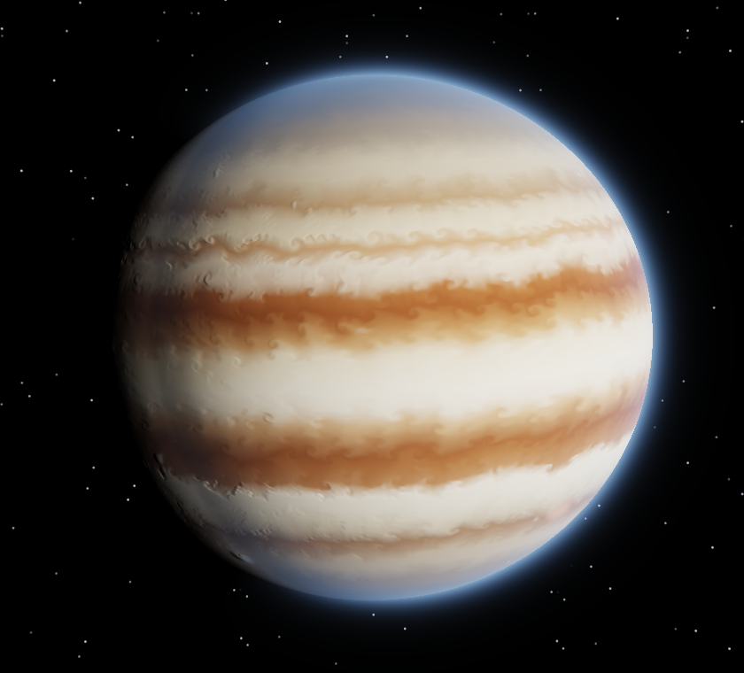
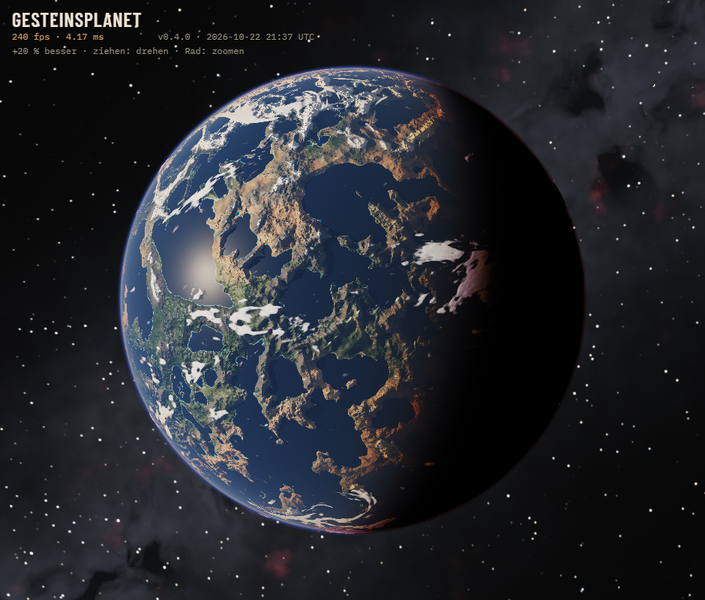
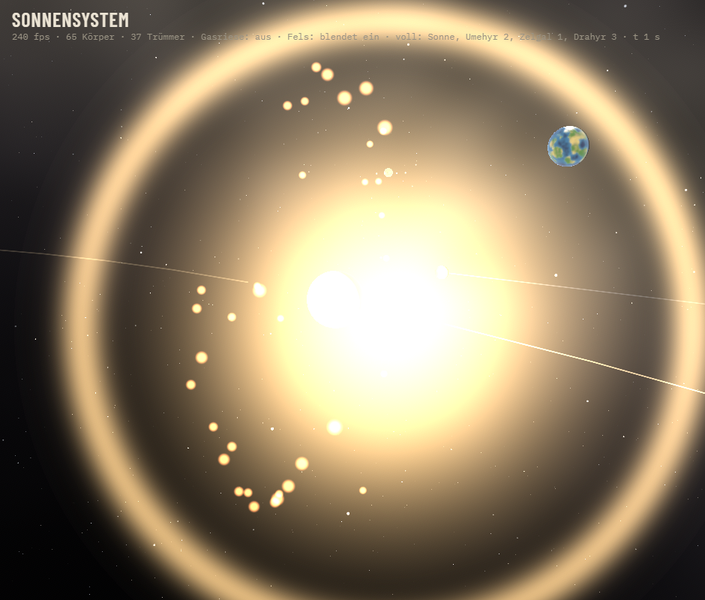
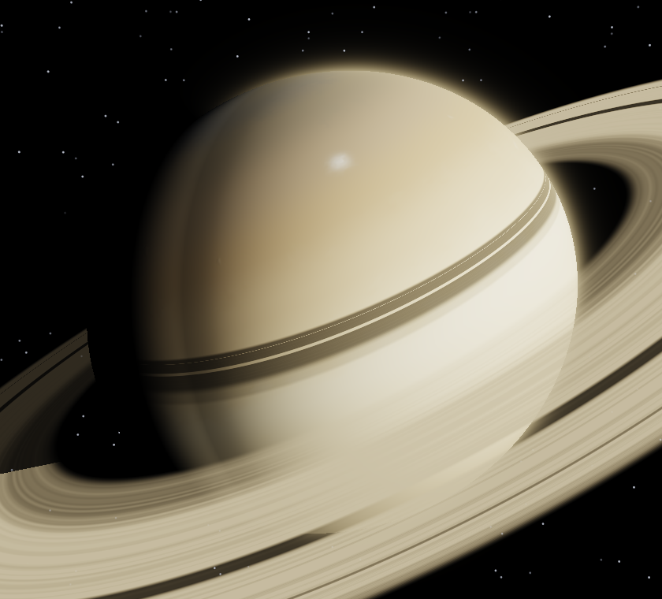
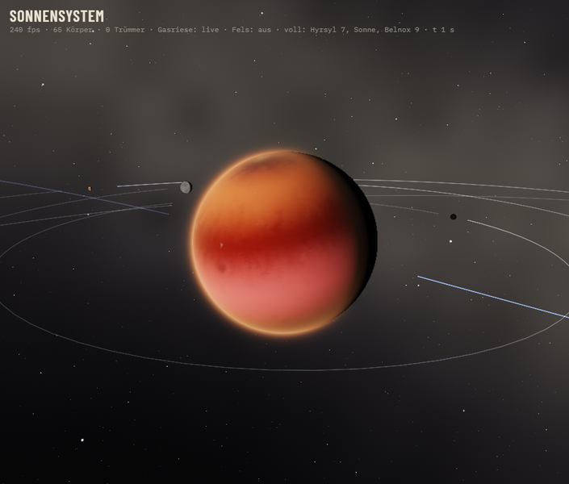
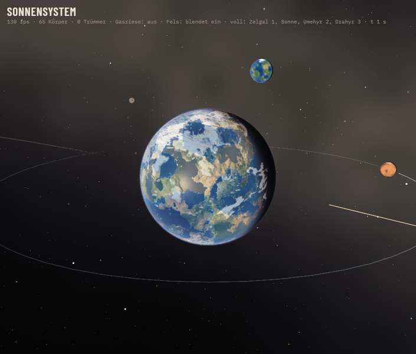

# Procedural Planets

**Real-time planets in the browser, computed and not painted.** Gas giants come from a fluid
simulation on a sphere. Rocky planets get terrain, rivers, oceans, air and clouds generated from a
seed, and a whole solar system with dozens of bodies runs on Newtonian gravity with physically
modelled collisions. Everything is drawn with WebGPU, and there are no image textures: every cloud
band, coastline and debris cloud comes from equations and numbers.

<p align="center">
  
</p>

**▶ Play it now (no install):**
[Solar system](https://loveascent.github.io/procedural-planets/index.html?body=welt) ·
[Gas giant](https://loveascent.github.io/procedural-planets/index.html) ·
[Rocky planet](https://loveascent.github.io/procedural-planets/index.html?body=rocky) ·
[Moon](https://loveascent.github.io/procedural-planets/index.html?body=moon) ·
[Cream in coffee](https://loveascent.github.io/procedural-planets/coffee.html) ·
[every version since v0.1](#versions-from-the-first-prototype-to-the-solar-system)

Needs a browser with WebGPU: Chrome/Edge 113+, Safari 26+, Firefox 141+, Android Chrome 121+.
The interface speaks English and German (button at the top right).

Created by **loveascent** · [Apache License 2.0](LICENSE) · [Sources and credits](CREDITS.md) ·
[How to cite](CITATION.cff) · [Deutsch](README.de.md)

| Gas giant | Rocky planet | Impact in the solar system |
|---|---|---|
|  |  |  |

| Saturn | A gas giant inside the system | A rocky planet inside the system |
|---|---|---|
|  |  |  |

*All images are renders of this project, not photos. The solar system and rocky planet images were
taken on an RTX 5080 at 1280 × 800, where the status line showed 130–240 fps with 65 bodies.*

---

## What you can do

- **Solar system:** a sun, 20 planets and their moons, one seed for the whole system. Fly to any
  body (double-click), throw asteroids at it or set two planets on a collision course, change the
  time speed, and save or load the system as a file, in the browser or as a short code. Every body
  has a fact sheet with values from the running simulation.
- **Gas giant:** Jupiter, Saturn, Uranus, Neptune, a hot Jupiter, or a random planet from five
  families. About 50 controls, each explaining what it changes physically and showing its formula.
  Includes undo/redo, save slots, planet codes for sharing, and “colours from image”.
- **Moon:** the rocky-planet engine without sea, air and clouds, with a crater formula (lunar depth/diameter laws, rims, central peaks,
  soil-creep softening) in place of the volcano formula: grey highlands, dark maria, real relief and shadows, zoom down to single craters.
- **Rocky planet:** a new world for every seed, with sea level, erosion, mountain belts, rivers and
  lakes, volcanoes, sea ice, clouds and atmosphere. A switchable “original 1:1” mode reproduces
  the method this module started from.
- **Every feature is a switch.** Gas giant, rocky planet and solar system are built from small
  building blocks. Each one can be turned off, and turned-off shader parts are not even compiled,
  so you can see exactly what each block contributes.

## Versions: from the first prototype to the solar system

Every version is a tagged commit in this repository (`git checkout v0.4.0`). The frozen builds can be
played directly in the browser.

| Version | Date | What came in | Play |
|---|---|---|---|
| **v0.1.0** | 2026-09-25 | Gas giant prototype: Stable Fluids and particle tracks on a cube sphere, five planets, explained controls | [gas giant v0.1](https://loveascent.github.io/procedural-planets/gas-v0.1.html) |
| **v0.2.3** | 2026-09-25 | Loading screen, auto quality, random planets, save slots, planet codes, undo/redo, cream-in-coffee demo | [coffee](https://loveascent.github.io/procedural-planets/coffee.html) |
| **v0.4.0** | 2026-09-26 | Separate fluid, particle and hybrid tracks; frame-rate independent simulation; retrograde spin; formula for every control; film-strip recorder | [gas giant v0.4](https://loveascent.github.io/procedural-planets/gas-v0.4.html) |
| **v0.5.0** | 2026-09-27 | Rocky planets next to the gas giants; a shared Milky Way sky | [rocky v21](https://loveascent.github.io/procedural-planets/planets-v21.html) |
| **v0.6.0** | 2026-09-28 | Quadtree terrain tiles, rivers and lakes computed from the terrain, volcanoes, rivers rendered as sea water | [v22](https://loveascent.github.io/procedural-planets/planets-v22.html) · [v23](https://loveascent.github.io/procedural-planets/planets-v23.html) · [v24](https://loveascent.github.io/procedural-planets/planets-v24.html) · [v25](https://loveascent.github.io/procedural-planets/planets-v25.html) |
| **v0.7.0** | 2026-09-29 | One page for all bodies, frozen versions selectable in the header, relief, parallax self-shadow, twilight rim, searchable menus | [current page](https://loveascent.github.io/procedural-planets/index.html) |
| **v0.8.0** | 2026-10-06 | Everything split into switchable building blocks; deterministic image tests prove the split changed no pixel | (source) |
| **v0.9.0** | 2026-10-06 | Solar system: 20 planets, moons and a sun, N-body gravity, collisions with fragmentation and debris | (source) |
| **v1.1.0** | 2026-10-24 | Moon (`?body=moon`): rocky-planet engine with a crater formula instead of the volcano formula | [moon](https://loveascent.github.io/procedural-planets/index.html?body=moon) |
| **v1.0.0** | 2026-10-06 | Collision model after Leinhardt & Stewart (2012), real gas giants and rocky planets running live inside the system, save/load, fact sheets | [solar system](https://loveascent.github.io/procedural-planets/index.html?body=welt) |

The same frozen versions can also be picked from the “current” menu in the page header. A galaxy map
with many solar systems is planned and shown greyed out in the header.

## How it works

### Gas giants: a fluid on a sphere (`src/gas/`)
- **Stable Fluids on a cube sphere** (Stam 1999; GPU structure after Harris 2004). Semi-Lagrangian
  advection with BFECC/MacCormack correction, a pressure projection with Jacobi iterations, Coriolis
  force and vorticity confinement (Fedkiw et al. 2001). A cube sphere instead of a latitude/longitude
  map means there is no pole singularity. Wind is stored as 3D tangent vectors, derivatives use the
  real grid metric, and sampling stays exact across cube edges.
- **Jets and storms from measurements:** zonal wind profiles after Cassini/Hubble data (Porco et al.
  2003; Tollefson et al. 2017; García-Melendo et al. 2011; Sromovsky et al.) drive the bands. Storms
  are vortices whose sense of rotation follows the local shear.
- **Particle track:** millions of particles advected by curl noise (Bridson et al. 2007) that fade to
  a mean colour, after jasper-r's particle sim and the Gaseous Giganticus recipe. Fluid, particle and
  hybrid run as separate tracks instead of one mixed method.
- **Fixed time step:** the simulation advances in fixed steps independent of the frame rate, so a
  60 Hz laptop and a 240 Hz desktop show the same atmosphere, and time lapse keeps the physics.
- **Rendering:** oblate ellipsoid, Minnaert limb darkening, cloud relief with parallax self-shadow,
  haze rim, rings with shadows, ACES tone mapping.

### Rocky planets: terrain, water and air from a seed (`src/rocky/`, `src/sky/`)
- **Terrain:** per-face height and moisture maps on a cube sphere from fBm and ridged simplex noise
  (method after colordodge/ProceduralPlanet), mountain belts as ridged multifractals (Musgrave),
  erosion gullies along r̂ × ∇h.
- **Level of detail:** quadtree terrain tiles with geomorphing (CDLOD, Strugar 2009), so there are no
  straight mesh edges when you zoom in.
- **Hydrology:** sinks filled into lakes with Priority-Flood (Barnes et al. 2014), flow accumulation
  (O'Callaghan & Mark 1984), and river width and depth from hydraulic geometry (Leopold & Maddock 1953).
- **Water and air:** sun glint after Cox & Munk, water absorption after Pope & Fry, atmospheric
  transmittance tables after Bruneton, Rayleigh/Mie/ozone coefficients after Hillaire, clouds with
  domain-warped noise and Henyey-Greenstein forward scattering, GGX highlights, bloom.

### Moon: the rocky-planet engine with a crater formula instead of the volcano formula (`src/rocky/shader/krater.js`)
- **Same engine as the rocky planet** (`?body=moon`): quadtree-free cube-sphere height maps, per-pixel fine detail, shadows, relief. Sea, air, clouds and rivers are off.
- **Craters** replace the volcano hook (`hook_vulkan_hoehe`): one crater per cell of a 3D grid per size step (each step half as big, 4x as many),
  depth by the lunar laws (Pike 1977: simple d = 0.196 D up to ~15 km, complex d = 1.044 D^0.301 km), rim h = 0.036 D^0.399 km, flat floor and
  central peak for complex craters, ejecta ~ t^-3, softening by soil creep ~ 1/D^2 (small craters fade first), analytic gradient for the lighting.
- **Colour:** grey highlands, dark maria where the moisture field is high, steep slopes brighter (fresh rock).

### Solar system: physics on the CPU, looks on the GPU (`src/welt/`)
- **Gravity:** Newtonian N-body with a symplectic leapfrog integrator (kick-drift-kick) at a fixed
  sub-step of 1/120, with softening against near-miss singularities. Images are interpolated between
  physics steps, so slow time does not stutter. Planets can feel only the sun and their moons
  (stable), or all bodies (“chaos”, orbits drift apart).
- **Collisions:** outcome regimes after Leinhardt & Stewart (2012): merge, hit-and-run, partial
  accretion, erosion and super-catastrophic disruption, with the largest remnant and the debris mass
  from their scaling laws, cross-checked against the REBOUND implementation by Childs & Steffen (2022).
  Debris leaves at about half the impact speed, after Emsenhuber et al. (2024). Mass and momentum
  are conserved, which `npm run pruefen:welt` checks.
- **Orbits** are drawn as Keplerian ellipses or hyperbolas computed from position and velocity.
- **Level of detail:** distant bodies are baked spheres, tiny ones are points, and the nearest large
  gas giant and rocky planet run as **real simulation instances** of the planet modules above,
  sharing one GPU device, with shadows and eclipses between bodies.
- **Reproducible:** one seed describes the whole system. Saving stores every body, every setting and
  the camera.

### Principles
- **Physics before effects:** every behaviour should come from an equation you can name. Where the
  code cheats, the docs say so.
- **Measure, don't guess:** deterministic image tests (`werkzeug/bild`, `werkzeug/gas`) render fixed
  scenes and compare them pixel by pixel, and physics tests check the collision model against the
  published equations.
- **Traceable:** every formula with its place in the code in [docs/MATH.md](docs/MATH.md), every
  source in [CREDITS.md](CREDITS.md).

## Build and run

```bash
npm install
npm run dev            # http://localhost:5173 (?body=rocky, ?body=welt)
npm run build          # dist/index.html and demo/: self-contained single files
npm run pruefen:welt   # physics tests of the solar system (collisions, conservation)
```

`demo/index.html` is one self-contained file with all three bodies.
GitHub Pages publishes `demo/` on every push to `main` (workflow in `.github/workflows/pages.yml`).

## Layout

```
src/app.ts, shell.ts   one page for all bodies (?body=gas|rocky|welt), header, version picker
src/gas/               gas giant: fields, compute passes, storms, rendering, menus (one file per block)
src/vorlagen/          planet presets as numbers (Jupiter, Saturn, ...), random planets
src/rocky/             rocky planet: terrain, quadtree, hydrology, water, air, clouds (shader blocks in shader/)
src/sky/               shared star and Milky Way sky
src/welt/              solar system: physik/ (gravity, collisions, scenarios), zeichnen/ (rendering), oberflaeche/ (panel)
src/bedienung/         control panel building blocks (search, sliders, tooltips)
demos/coffee.html      cream in coffee (standalone)
demo/                  ready-to-run builds, including all frozen versions
docs/                  STATUS, ROADMAP, MATH, RESEARCH (English); docs/de/: German
werkzeug/              image and physics test tools
```

## Sources

The project builds on published methods and data. No third-party code was copied, except two small
MIT-licensed noise and hash functions whose license text sits next to the code. The full list with
what each source was used for is in [CREDITS.md](CREDITS.md). The main sources are:

- J. Stam, *Stable Fluids*, SIGGRAPH 1999 · M. Harris, *Fast Fluid Dynamics Simulation on the GPU*, GPU Gems 2004
- R. Fedkiw et al., *Visual Simulation of Smoke*, SIGGRAPH 2001 · A. Selle et al., MacCormack method, 2008
- R. Bridson et al., *Curl-Noise for Procedural Fluid Flow*, SIGGRAPH 2007
- jasper-r, *Gas giant particle sim on a sphere* (2022) · S. Cameron, *Gaseous Giganticus* (recipe only)
- colordodge, *ProceduralPlanet* (WTFPL) · Ashima Arts / S. Gustavson, *webgl-noise* (MIT) · D. Hoskins, *Hash without Sine* (MIT)
- F. Strugar, *CDLOD* (2009) · R. Barnes et al., *Priority-Flood* (2014) · Leopold & Maddock (1953)
- E. Bruneton (2017) and S. Hillaire (2020), atmospheric scattering · Cox & Munk (1954) · Henyey & Greenstein (1941)
- Z. Leinhardt & S. Stewart, *Collisions between Gravity-Dominated Bodies*, ApJ 745, 79 (2012)
- A. Emsenhuber et al., *A New Database of Giant Impacts*, PSJ (2024) · S. Childs & J. Steffen, REBOUND fragmentation (2022)
- Wind profiles: Porco et al. 2003, Tollefson et al. 2017, García-Melendo et al. 2011, Sromovsky et al. 1993/2015

## License

[Apache License 2.0](LICENSE). You may use, modify and redistribute the project, including
commercially. Redistributions and derivative works must keep the [NOTICE](NOTICE) file
(section 4(d)). Please cite the project as in [CITATION.cff](CITATION.cff).
Fonts: IBM Plex and Barlow Condensed (SIL OFL), loaded from Google Fonts.
Built with Vite, TypeScript and vite-plugin-singlefile (MIT).

Implemented with the help of Claude (Anthropic) as an AI programming assistant.
